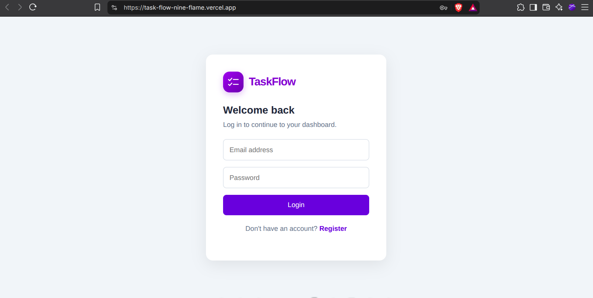
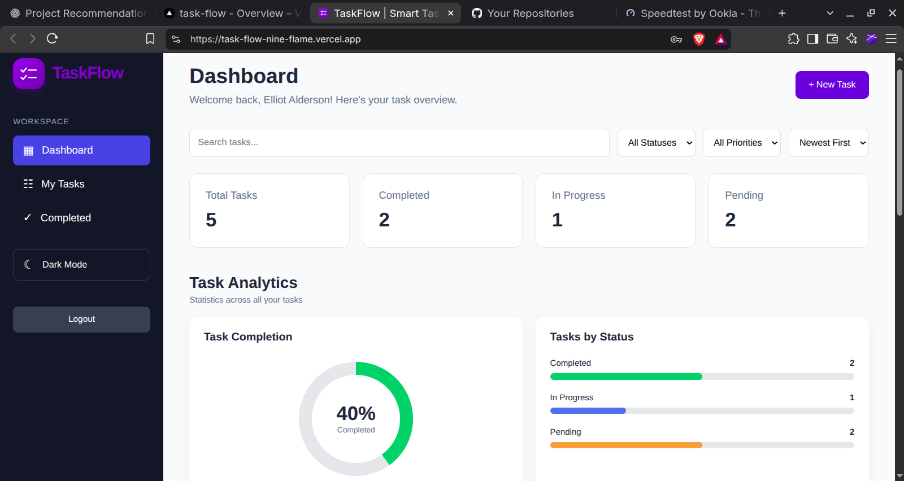
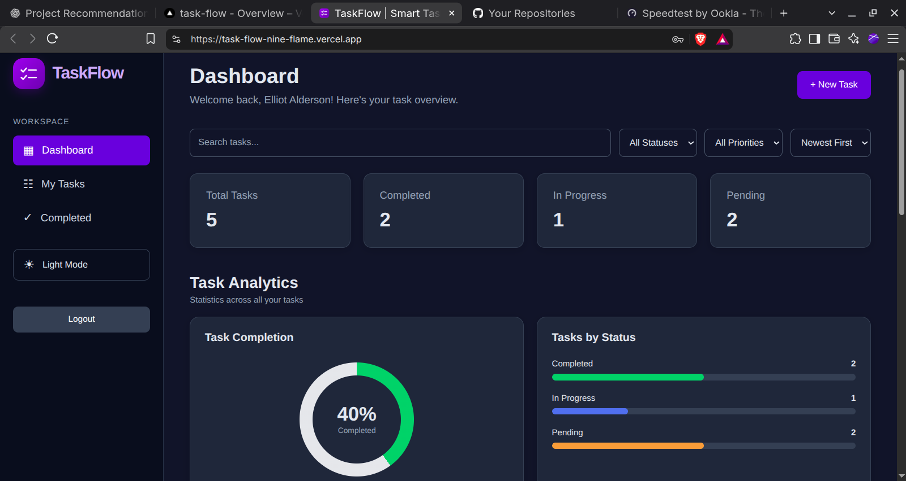
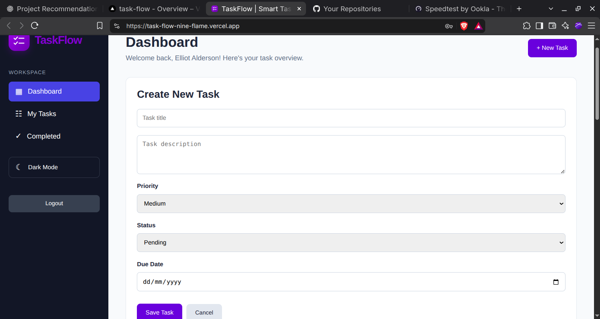
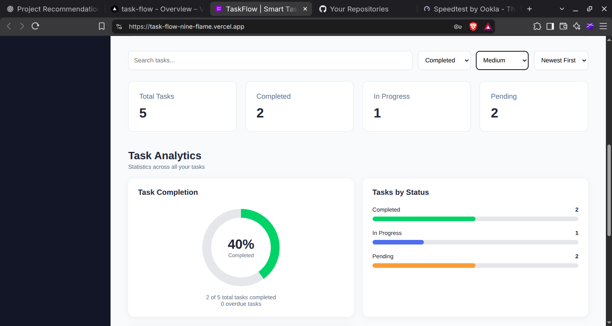

# TaskFlow – Full-Stack Task Management Application

A modern, full-stack task management application built using the MERN stack. TaskFlow helps users organize their work, manage daily tasks, track progress, and stay productive through a clean and intuitive interface.

## 🚀 Live Demo

**Frontend:** [TaskFlow – Live Application](https://task-flow-nine-flame.vercel.app/)

**Backend:** Deployed on Render

## 📸 Screenshots

### 1. Login & Registration



### 2. Dashboard – Light Theme



### 3. Dashboard – Dark Theme



### 4. Create Task



### 5. Task Management



## ✨ Features

- **User Authentication:** Secure registration and login using JWT-based authentication.
- **Task Management:** Create, view, update, and delete tasks.
- **Persistent Storage:** Store tasks in MongoDB so they remain available after refreshing or logging in again.
- **Search & Filtering:** Find and organize tasks using available filters.
- **Pagination:** Navigate through tasks efficiently with paginated results.
- **Task Prioritization:** Organize tasks based on priority.
- **Analytics Dashboard:** View task statistics and monitor progress.
- **Dark & Light Themes:** Switch between themes directly from the dashboard.
- **Responsive Interface:** Access the application across desktop and mobile devices.

## 🛠️ Tech Stack

| Category | Technologies |
|---|---|
| Frontend | React.js, Vite, CSS |
| Backend | Node.js, Express.js |
| Database | MongoDB, Mongoose |
| Authentication | JSON Web Tokens (JWT) |
| API Testing | Postman |
| Deployment | Vercel, Render |
| Version Control | Git, GitHub |

## 📁 Project Structure

```text
TaskFlow/
├── backend/
│   ├── config/
│   ├── controllers/
│   ├── middleware/
│   ├── models/
│   ├── routes/
│   ├── .env.example
│   └── server.js
├── frontend/
│   ├── public/
│   ├── src/
│   └── package.json
├── docs/
│   └── screenshots/
│       ├── 01-login.png
│       ├── 02-dashboard-light.png
│       ├── 03-dashboard-dark.png
│       ├── 04-create-task.png
│       └── 05-task-management.png
└── README.md
```

## ⚙️ Installation & Setup

### 1. Clone the Repository

```bash
git clone https://github.com/Tribalchiefcoder/TaskFlow.git
cd TaskFlow
```

### 2. Set Up the Backend

```bash
cd backend
npm install
```

Create a `.env` file using `backend/.env.example` as a reference. Configure your MongoDB connection string, JWT secret, and other required variables.

Start the backend:

```bash
npm run dev
```

### 3. Set Up the Frontend

Open another terminal:

```bash
cd TaskFlow/frontend
npm install
```

Create a `.env` file inside the frontend directory:

```env
VITE_API_URL=http://localhost:5000/api
```

Start the frontend:

```bash
npm run dev
```

### 4. Open the Application

Visit the local development URL provided by Vite, usually:

`http://localhost:5173`

## 🔐 Environment Variables

**Frontend**

| Variable | Description |
|---|---|
| `VITE_API_URL` | Backend API base URL |

**Backend**

- MongoDB connection string.
- JWT secret.
- Server port.
- Any additional variables specified in `backend/.env.example`.

Never commit actual credentials, secrets, or `.env` files to GitHub.

## 🔌 API Overview

The backend provides RESTful API endpoints for authentication and task management.

| Method | Endpoint | Description |
|---|---|---|
| POST | `/api/auth/register` | Register a new user |
| POST | `/api/auth/login` | Authenticate a user |
| GET | `/api/tasks` | Retrieve tasks |
| POST | `/api/tasks` | Create a task |
| GET | `/api/tasks/:id` | Retrieve a specific task |
| PUT | `/api/tasks/:id` | Update a task |
| DELETE | `/api/tasks/:id` | Delete a task |
| GET | `/api/tasks/analytics` | Retrieve task analytics |

Protected task endpoints require a valid JWT authentication token.

## 🎯 Project Objectives

TaskFlow was developed to strengthen practical full-stack development skills, including:

- Building REST APIs using Express.js.
- Implementing JWT authentication and protected routes.
- Connecting a React frontend with a Node.js backend.
- Managing application data using MongoDB.
- Implementing pagination, filtering, and CRUD operations.
- Deploying a full-stack application using Vercel and Render.

## 👨‍💻 Author

**Sumedh Varadkar**

- GitHub: [@Tribalchiefcoder](https://github.com/Tribalchiefcoder)

---

If you find this project useful, consider giving the repository a ⭐ on GitHub!
